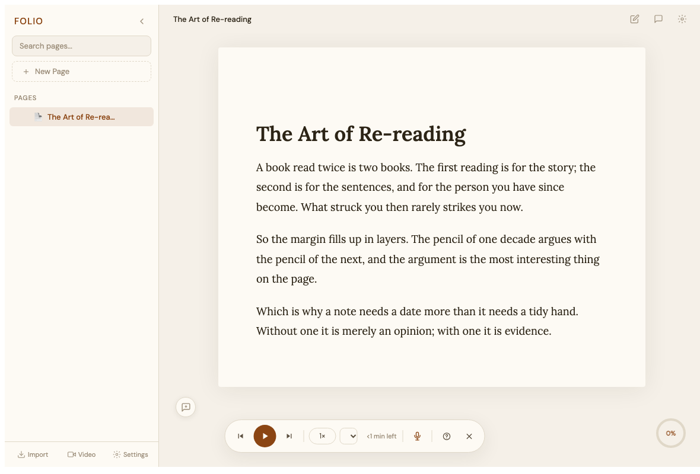
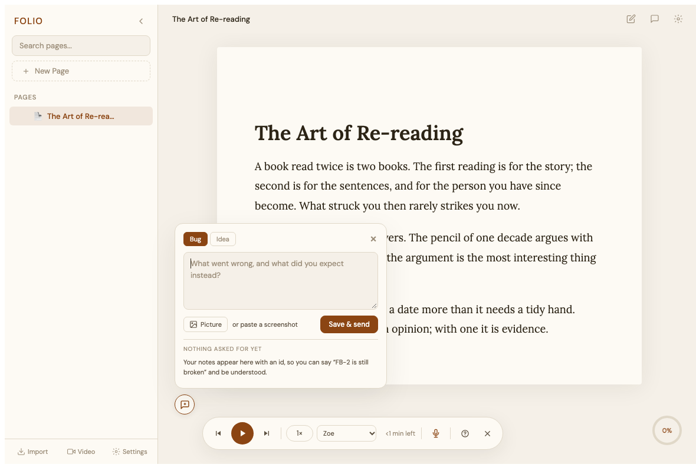
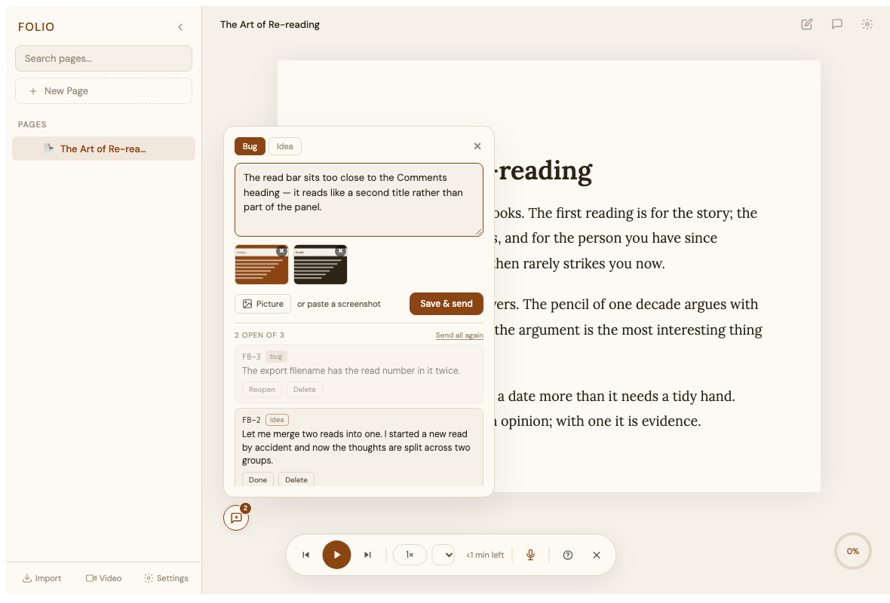
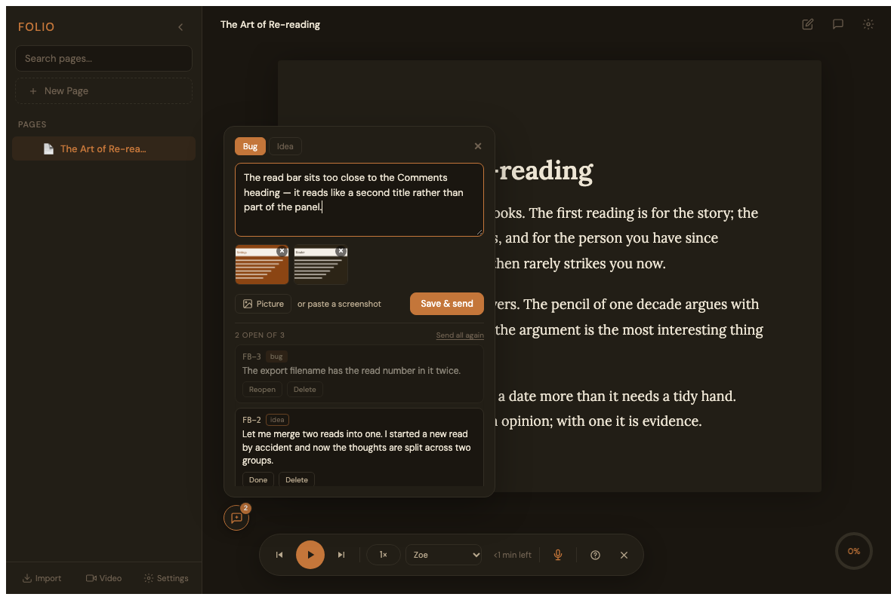
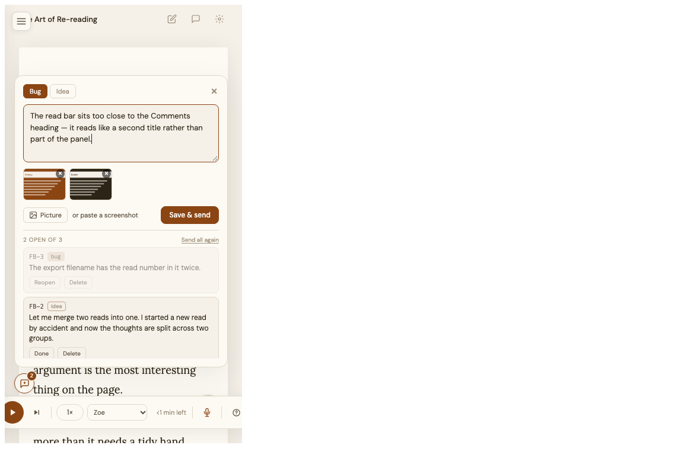

# The feedback box — writing a note inside Folio and having Claude read it

## TL;DR

- **What was asked:** a small thing at the bottom left of Folio where you can paste a
  screenshot and write feedback or a feature request, so that later you can just say
  *"please fix/build the features I asked for"* and I know what you meant.
- **The hard part is not the box, it is the bridge.** Folio has no backend and
  localStorage cannot be read from outside the browser, so a note saved in Chrome is
  invisible to me. The note has to reach a file on disk.
- **The bridge is a download.** Pressing save writes one JSON bundle into
  `~/Downloads`, which I can read. `tools/feedback-inbox.js` then files every item into
  `docs/feedback/folio/BIBLE.md` and writes the screenshots into
  `docs/feedback/folio/images/`, following the feedback-pipeline conventions.
- **Every note gets a permanent id you can see** — `FB-1`, `FB-2` — shown in the list
  inside Folio, so you can say "FB-3 is still broken" and we both know what that means.
- **Send happens before storing, deliberately.** If the browser refuses to keep the
  note (screenshots are big and localStorage is small), the note has already left the
  building. Losing the record is acceptable; losing the feedback is not.
- **Screenshot bytes are dropped once sent**, so the box cannot slowly eat the storage
  your documents live in.

## Document map

**What you asked for** is the request and what I read into it · **Why a download**
explains the three bridges I considered and why the other two lose · **What it looks
like** is the UI and where it sits · **The data** is the shape of a note and the
storage key · **The ingest tool** is what I run when you say "fix what I asked for" ·
**What it looks like in the end** is the five pictures · **What looking at it found**
is the three rounds of the designer pass, including a bug every test passed through ·
**How it was tested** is the three layers and the sixteen mutations · **What I did not
do** is the honest gap list.

## What you asked for

**Your words:** *"Can you please add a small thing at the bottom left, where I can
attach screenshot (optional) by pasting in the screenshot, and attach feedback or
feature requests? This will help because then I can just say: Please fix/build the
features i asked for."*

Four requirements, and the fourth is the one that decides the design:

1. Small, at the bottom left.
2. A screenshot can be attached by **pasting** it. Optional.
3. Feedback **or** feature requests — two kinds of note.
4. Later, "please fix the features I asked for" must be enough. **That means the notes
   have to be somewhere I can read without you doing anything else.**

## Why a download, and not something cleverer

**Folio has no server, so there are only three ways a note written in Chrome can reach
a file in this repository.** I considered all three.

| Bridge | Why not, or why yes |
|---|---|
| **localStorage only** | Loses immediately. I cannot read your browser's storage. The notes would be visible to you and invisible to me, which fails requirement 4 entirely. |
| **File System Access API** | Technically the best answer: you pick `docs/feedback/folio/` once and Folio writes straight into the repo. But the directory handle can only be kept in IndexedDB, and `CLAUDE.md` says not to introduce IndexedDB without discussing it. It also needs a fresh user gesture to re-grant after a browser restart, and it would need granting separately on every origin — the Vercel site, each localhost port, and the Electron panel are four different Folios ([[folio-storage-is-per-origin]]). |
| **A download** | Needs no permission, no new storage engine, works identically on every origin including the Electron panel, and lands in `~/Downloads`, which I read with one command. **Chosen.** |

**The cost of the download bridge is one extra file in your Downloads folder per save.**
That is the whole downside, and it buys a bridge that cannot break.

## What it looks like, and where it sits

**A 34px round button at the bottom left, quiet enough to read past.** It carries a
small accent dot with a count when notes are waiting.

It is anchored to the bottom left of the *reading area*, not the viewport, because the
viewport's bottom left is where the sidebar's Import / Video / Settings buttons already
are. So it sits at `left: 288px` normally and slides to `left: 28px` when you collapse
the sidebar, via `body:has(#sidebar.collapsed)`. Below 768px — which includes the 400px
Electron panel — it goes to the edge, because there the sidebar is an overlay.

**Pressing it opens a card above it** with:

- **Two kind buttons, Bug and Idea**, because requirement 3 asked for both and they get
  read differently: a bug is something to diagnose, an idea is something to decide on.
- **A textarea**, focused immediately so you can start typing without aiming.
- **Screenshots**, attached by pasting into the card, by dropping a file on it, or by
  the "add a picture" button. Thumbnails appear in a strip, each removable.
- **One primary button: "Save & send"**. There is no separate send step, because a
  second step is a step you can forget, and forgetting it is exactly the failure that
  makes "fix what I asked for" come back empty.
- **The list of notes you have already written**, each with its id, each with a tick to
  mark it done yourself and a bin to delete it.

**Pasting a screenshot with the card closed opens the card with the picture already
attached.** That makes the whole flow: screenshot, Cmd-V, type, Cmd-Enter. `Cmd+Shift+F`
opens the card from the keyboard.

## The data

**One new storage key, `folio_feedback`, holding an array of notes.** Nothing else in
Folio changes shape.

```
{ id: "fb_<ts>_<rand>",     // internal, never shown
  n: 3,                      // the number in "FB-3", from folio_feedback_seq
  kind: "bug" | "idea",
  text: "...",
  shots: [{ name, type, w, h, bytes: "<base64>" | null, sent: true }],
  context: { href, docId, docTitle, mode, readLabel, theme, viewport, ua },
  createdAt, sentAt, status: "open" | "done" }
```

**Screenshots are downscaled to 1800px on the longest side before anything else
happens**, because that is the limit above which Claude Code refuses an image, and
because a Retina screenshot is otherwise several megabytes of base64 in a store that
holds about five in total.

**`bytes` is set to null the moment a note has been sent.** The bundle that went to
Downloads carries the picture; keeping a second copy in the browser would mean the
feedback box slowly consuming the space your documents live in. The thumbnail strip
shows a placeholder for a sent picture rather than pretending it is still there.

**Send happens before the save, on purpose.** `setItem` can throw `QuotaExceededError`
and that is a real possibility with pictures involved. Downloading first means a full
disk or a full quota costs you the *record* of the note, never the note itself.

## The ingest tool

**`node tools/feedback-inbox.js` is what I run when you say "fix what I asked for".**

It reads **every** `folio-feedback-*.json` in `~/Downloads`, not only the newest,
because each bundle carries picture bytes only for the notes that were unsent at that
moment. It merges them by internal id, newest wins for the text and the status, and any
bundle that has the bytes supplies the picture.

Then it writes, following `~/.claude/rules/feedback-pipeline.md`:

- `docs/feedback/folio/BIBLE.md` — one row per note, your words **verbatim**, with the
  id you saw in Folio, the category, and a status column.
- `docs/feedback/folio/images/FB-3_1.png` — every screenshot, named by its note.
- `docs/feedback/folio/.ingested.json` — which bundles and ids have already been filed,
  so running it twice does not duplicate anything or renumber an id.

It prints the count of new notes out loud, because a silent ingest is indistinguishable
from a broken one.

## What it looks like in the end

**Five states were rendered and looked at, which is how the worst bug in this
feature was found.**

| | |
|---|---|
|  | **At rest.** One 34px button at the bottom left, lifted clear of the read-aloud player when that is up. |
|  | **Opened, empty.** Kind, words, picture, one button. |
|  | **In use.** Two screenshots attached and three notes already written, each with the id you can quote. |
|  | **The warm dark theme**, which is where the contrast problem showed up. |
|  | **At 400px**, the width of the Electron panel. |

## What looking at it found, which no test did

**Three rounds of rendering, and the first round found a bug that every
assertion had been passing through.**

**Round 1 — the read-aloud player was drawn straight across the open card.**
The player bar is fixed at `bottom: 24px` and `z-index: 170`; the box was at the
same bottom edge and `z-index: 95`. Both are at the bottom of the screen and the
player is centred, so it grows towards the button as the window narrows. Now the
button lifts to `bottom: 84px` while the player is up, and an open card outranks
it. Four other things in the same round: the card could grow taller than a short
window; the notes list was cut through the middle of a sentence with nothing
saying it scrolled; the 58px thumbnails showed a coloured block and nothing else;
and **"bug" and "idea" were two tints of the same brown, indistinguishable at
9px** — which defeats the point of having two kinds. The tags now differ in shape
rather than hue, a filled chip against an outlined one, which also survives being
colour-blind.

**Round 2 — the fix for the cut-off list made something worse.** Fading the
bottom of the list did say "there is more below", but the fade landed across a
row's Done and Delete buttons and made them look **disabled**, which is a worse
lie than the one it fixed. It was also solving a problem that partly did not
exist: the list has a real scrollbar, and the only reason the first picture had
none is that the screenshot script passes `--hide-scrollbars`. That lie is now
written into the script itself so it is not re-diagnosed. The signal is a soft
line at the list's edge, which overlaps nothing.

**Round 3 found the actual bug, and it is the one worth remembering.** A state
that should have been the card closed came out with the card open. The cause:
`#feedback-card { display: flex }` **overrides the browser's own
`[hidden] { display: none }`**, because an id selector wins. So the card was
painted on screen from the moment the page loaded — permanently, in every state,
on both entry points.

**The probe had passed through all of it**, because every assertion asked
`card.hidden`, and that property was perfectly, truthfully `true`. The element
was marked hidden and drawn anyway. **Only a picture found it.** Every one of
those assertions now asks `offsetParent !== null`, which asks the layout instead
of the property, and a new assertion checks the resting state before anything is
clicked — which nothing had ever done. Removing the one-line CSS fix now fails
seven assertions; before, it failed none.

**Round 4 found nothing**, which is the point at which a designer pass stops.

## How it was tested

**Three layers, because each catches what the others structurally cannot.**

- `test/feedback.selftest.js` — the store rules under jsdom: numbering, the byte
  pruning, send-before-save, the bundle shape, status changes, deletion.
- `test/browser/feedback.probe.html` — the real app in headless Chrome: that the button
  exists where it should, that pasting an image attaches it, that the card opens on
  paste when closed, that a save produces a download and a row in the list.
- `test/browser/feedback.shot.html` + `tools/shoot-feedback.sh` — renders the box for a
  screenshot, because no assertion will tell either of us whether it looks right.

**Sixteen mutations were run**: each rule was broken one at a time, the suite that
guards it was watched to fail, and the rule was restored. All sixteen were caught.

**One of them was not, the first time, and the test was wrong rather than the
code.** The assertion that the tool recovers an older picture checked that a file
was still on disk — but that file had been written by an earlier part of the same
suite and nothing deletes it, so it passed with the merge rule removed entirely.
It now files both bundles into a folder that has never been written to, where the
picture can only appear if the tool really went back to the older bundle.

**The probe used to leave a file in the real Downloads folder on every run.**
Fourteen of them had accumulated before anyone noticed — which did at least prove
the download bridge works end to end in a real browser. The probe now lets the
module's own code run and only stops Chrome from saving the file.

## What I did not do

- **Nobody has used this on a real document yet.** The status is BUILT, not DONE.
- **No File System Access bridge**, so there is still one manual step on my side: I run
  the ingest tool. You do not have to do anything, but I do.
- **I cannot write back into your Folio.** When I fix something, nothing in the browser
  turns green by itself — you tick it done, or I tell you and you tick it.
- **The downloads accumulate.** Nothing prunes `~/Downloads`; the ingest tool reads them
  and leaves them. If that gets annoying it can move them after filing.
- **No editing a note after saving.** Delete it and write another.
- **Not tested in the Electron panel** — the markup is in `index-electron.html` and the
  sizing accounts for 400px, and the 400px picture above is the web page at that width.
  The panel also loads `electron/panel.css`, which I have not run.
- **The read-aloud bar and the box were only checked at 1180px and 400px wide.** The
  lift rule should cover everything between, but I did not measure every width.
- **Numbering is per origin.** A note written on Vercel and a note written on localhost
  can both be FB-4. The ingest tool detects the collision and suffixes the second one,
  but the id you saw in Folio would then not match the bible for that one note.
